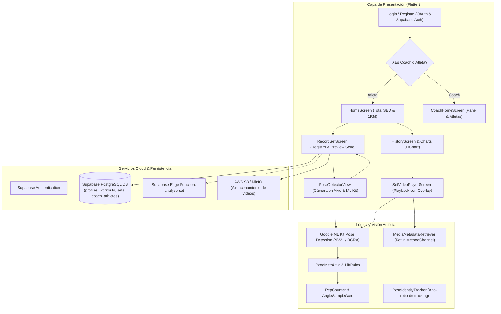

# Resumen Actual del Proyecto: Powerlifting AI App

Este documento presenta una síntesis exhaustiva de la aplicación **Powerlifting AI**, detallando el **propósito fundamental del proyecto**, la **totalidad de las funcionalidades implementadas**, y **cada una de las soluciones técnicas desarrolladas** para superar los desafíos biomecánicos, de visión artificial y de arquitectura.

---

## 1. Propósito y Visión General del Proyecto

### 1.1. ¿Qué es Powerlifting AI?
**Powerlifting AI** es una plataforma móvil integral (construida en Flutter con backend en Supabase y almacenamiento en la nube AWS S3) diseñada específicamente para la comunidad de **Powerlifting** (Levantamiento de Potencia). El sistema combina **visión por computadora en tiempo real en el dispositivo (Edge AI)**, **análisis biomecánico automatizado**, **evaluación cualitativa mediante modelos de lenguaje (LLM)** y un **ecosistema de gestión colaborativa entre Atletas y Coaches**.

### 1.2. Objetivos Principales
1. **Juicio y Arbitraje Biomecánico Objetivo:**
   - Evaluar con precisión los tres movimientos oficiales del powerlifting (**Squat / Sentadilla**, **Bench Press / Press de Banca** y **Deadlift / Peso Muerto**).
   - Validar automáticamente si el atleta cumple con los estándares reglamentarios de competición (romper la paralela en sentadilla $\le 88^\circ$, contacto en el pecho y extensión en banca $\le 92^\circ / \ge 150^\circ$, y bloqueo vertical de cadera y rodillas en peso muerto $\ge 160^\circ$).
2. **Eliminación de la Subjetividad y el Conteo Falso:**
   - Proveer un contador inteligente de repeticiones dotado de filtros temporales, detección de posición inicial estática e histéresis para evitar repeticiones fantasmas por rebotes o temblores.
3. **Telemetría del Movimiento (Bar Path / Trayectoria):**
   - Visualizar la trayectoria de la barra y el cuerpo para optimizar la eficiencia motriz y detectar desviaciones técnicas.
4. **Puente Atleta - Entrenador:**
   - Permitir a los entrenadores supervisar a su equipo, revisar videos con superposición de IA sincronizada fotograma a fotograma, y monitorear las marcas personales (PR) y el Total SBD.
5. **Feedback Cualitativo Personalizado:**
   - Transformar métricas angulares y temporales en recomendaciones prácticas sobre fortalezas, debilidades y fatiga neuromuscular.

---

## 2. Arquitectura General del Sistema

---

## 3. Estado de lo Implementado (Módulos y Características)

### 3.1. Autenticación, Onboarding y Roles
- **Múltiples métodos de acceso:** Inicio de sesión y registro clásico con Correo/Contraseña, además de integración con proveedores OAuth (**Google**, Apple y GitHub) mediante `AuthService`.
- **Detección inteligente de perfil incompleto:** Redirección automática a `CompleteProfile` tras el primer ingreso si faltan datos esenciales.
- **Doble Rol (Atleta vs Coach):**
  - **Atleta:** Acceso a registro de series, marcas personales, código QR propio y analítica de progreso.
  - **Coach:** Acceso a listado de atletas asignados, escáner QR de vinculación instantánea y monitoreo de levantamientos de su equipo.
- **Perfil Biométrico:** Registro de nombre, peso corporal, género y fecha de nacimiento con validaciones estrictas.

### 3.2. Panel Principal del Atleta (`HomeScreen`)
- **Header con Silueta y Total SBD:** Muestra el total acumulado en kilogramos o libras de los mejores 1RM de Squat, Bench y Deadlift.
- **Tarjetas de los 3 Grandes (SBD):** Tarjetas interactivas con fotografías para Squat, Bench y Deadlift, exhibiendo el 1RM actual calculado por fórmula de Epley. Al tocar una tarjeta, el ejercicio queda **fijado** para el registro.
- **Drawer de Configuración y Herramientas:** Acceso directo a:
  - *Mi código QR de Atleta*.
  - *Análisis de Técnica IA*.
  - *Selector global de Unidades de Peso* (Kg / Lb).
  - *Cerrar Sesión* con reinicio seguro de estado.
- **Historial Rápido:** Listado dinámico de los últimos 10 levantamientos con navegación hacia el detalle del entrenamiento.

### 3.3. Registro de Series y Fijación de Ejercicios (`RecordSetScreen`)
- **Ejercicio Fijo e Inmutable:** Resuelve la ambigüedad eliminando menús desplegables innecesarios. Muestra un banner visual con candado indicando el ejercicio seleccionado desde la pantalla previa (`SQUAT [🔒 Fijo]`).
- **Cálculo en Vivo de 1RM:** Estimación automática en tiempo real a medida que el atleta teclea el peso y las repeticiones (fórmula de Epley: $\text{1RM} = \text{Peso} \times (1 + \frac{\text{Reps}}{30})$).
- **Entrada de RPE:** Campo opcional para registrar el esfuerzo percibido (Rating of Perceived Exertion).
- **Auto-rellenado desde IA:** Si el atleta graba con la cámara IA, las repeticiones detectadas se autocompletan en el formulario.
- **Preview Visual Integrado:** Tarjeta con la curva del recorrido (Bar Path) capturada por la cámara antes de guardar la serie.
- **Diálogo de Confirmación Final:** Modal que desglosa repeticiones totales, válidas, ROM, ángulo y advertencia de subida de video antes de impactar Supabase.

### 3.4. AI Coach en Vivo: Visión por Computadora (`PoseDetectorView`)
- **Detección de Pose a 30 FPS:** Empleo de Google ML Kit en modo `stream` optimizado para dispositivos móviles.
- **Badge Dinámico de Confirmación:**
  - `¡CUERPO REGISTRADO Y RASTREADO!` (Verde brillante) al detectar los landmarks requeridos.
  - `BUSCANDO ATLETA...` (Ámbar) con instrucciones de encuadre si el atleta sale de foco.
  - `🔒 TRAZA BLOQUEADA` (Cian) cuando se activa el anclaje de alta estabilidad.
- **Esqueleto Completo y Trazas Activas Dinámicas:**
  - Dibuja el cuerpo en blanco translúcido.
  - Resalta las articulaciones involucradas en el ejercicio en curso con código semafórico:
    - **Verde:** ROM reglamentario alcanzado (profundidad / contacto / bloqueo).
    - **Ámbar:** En recorrido o fase excéntrica/concéntrica.
    - **Rojo:** Posición inicial o de reposo.
- **Trazador de Trayectoria (Bar Path / Motion Trail):** Historial gráfico de puntos que dibuja la línea de desplazamiento de la articulación clave (muñeca en banca/peso muerto, cadera en sentadilla) con efecto de desvanecimiento gradual.
- **Etiqueta Flotante Articular:** Muestra en grados el ángulo actual en tiempo real y el estado técnico directamente sobre la articulación analizada.
- **Modal de Preview Biomecánico:** Al presionar *"Ver Preview y Finalizar"*, se despliega una vista previa modal con:
  - Gráfico en miniatura de la curva de la barra.
  - Tarjetas de Reps Totales, Reps Válidas y Mejor Ángulo.
  - Calificación técnica cualitativa preliminar.
  - Botón para vincular las métricas a la serie.

### 3.5. Biomecánica y Algoritmo de Conteo de Repeticiones (`RepCounter`, `LiftRules`, `LiftVisuals`)
- **Reglas Específicas por Ejercicio:**
  - **SQUAT:** Evalúa la flexión de rodilla ($\text{Cadera} \to \text{Rodilla} \to \text{Tobillo}$). Válido al romper los $88^\circ$. Requiere inicio y bloqueo en $\ge 148^\circ$.
  - **BENCH:** Evalúa la flexión del codo ($\text{Hombro} \to \text{Codo} \to \text{Muñeca}$). Válido al tocar pecho ($\le 92^\circ$). Cierre en bloqueo ($\ge 150^\circ$).
  - **DEADLIFT:** Evalúa la extensión simultánea de cadera y rodilla ($\text{Hombro} \to \text{Cadera} \to \text{Rodilla} \to \text{Tobillo}$). Bloqueo válido cuando ambos ángulos alcanzan $\ge 160^\circ$.
- **Histéresis y Setup Hold:** Exige que el atleta permanezca quieto en la posición inicial durante al menos 500 ms antes de habilitar el conteo de una repetición.
- **Métricas Avanzadas del Set (`SetSummary`):** Detección de la mejor y peor repetición, dispersión angular, e identificación del punto de inicio de fatiga (primera repetición con degradación de $\ge 4^\circ$).

### 3.6. Almacenamiento en S3 y Reproducción con Overlay IA (`S3VideoService`, `VideoPoseAnalyzer`, `SetVideoPlayerScreen`)
- **Grabación y Carga a AWS S3 / MinIO:** Soporte para subir videos de series a un bucket S3 con generación de URLs presignadas para reproducción segura.
- **Extractor Nativo de Fotogramas (Android/Kotlin):** `MainActivity.kt` implementa un canal nativo (`powerliftingapp/video_frames`) con `MediaMetadataRetriever` para decodificar fotogramas a resolución escalada sin saturar la memoria RAM.
- **Reanálisis y Playback Sincronizado (`PlaybackPosePainter`):** El reproductor de video de la app permite reproducir la serie con el esqueleto y los ángulos superpuestos exactamente al ritmo del video, con un interruptor para activar o desactivar la visualización de la IA.

### 3.7. Análisis Cualitativo por IA / LLM (`AiFeedbackScreen`)
- **Generación de Feedback Técnico:** Disparo mediante Supabase Edge Function (`analyze-set`).
- **Vista de Diagnóstico:** Pantalla dedicada que muestra:
  - Resumen ejecutivo del levantamiento.
  - Fortalezas mecánicas demostradas.
  - Puntos de mejora / Errores técnicos a cuidar.
  - Recomendaciones para las siguientes sesiones de entrenamiento.

### 3.8. Panel del Entrenador y Vinculación QR (`CoachHomeScreen`, `AthleteQrScreen`, `ScanAthleteQrScreen`)
- **Código QR del Atleta:** Cada atleta genera un QR que encapsula su identificador único de Supabase en formato JSON (`athlete_link`).
- **Escáner QR para Coach:** Mediante `mobile_scanner`, el entrenador escanea el teléfono del atleta y lo vincula a su equipo al instante en la tabla relacional `coach_athletes`.
- **Dashboard de Atletas del Coach:** Visualización de cada miembro del equipo con sus marcas personales (Squat, Bench, Deadlift, Total SBD) y opción de desvincular con un solo toque.

### 3.9. Historial y Gráficos de Progresión (`HistoryScreen`, `WorkoutDetailScreen`)
- **Pestaña Historial:** Agrupación cronológica de sesiones de entrenamiento.
- **Pestaña Gráficos:** Gráfico de líneas interactivo multi-serie (`fl_chart`) que muestra la evolución histórica del 1RM estimado en el tiempo para Squat (rojo), Bench (azul) y Deadlift (verde).
- **Detalle de Entrenamiento:** Visualización de cada serie del día con opciones de editar peso/reps/RPE, reproducir el video guardado o eliminar la serie.

### 3.10. Sistema Global de Unidades de Peso (Kg / Lb)
- **Controlador Centralizado (`WeightUnitController`):**
  - Almacenamiento normalizado en la base de datos siempre en Kilogramos (`FLOAT`) para evitar inconsistencias numéricas.
  - Conversión dinámica a Libras mediante la constante internacional $1\text{ lb} = 0.45359237\text{ kg}$.
  - Protección contra drift numérico: al editar una serie, si el valor mostrado no cambió, se preserva el valor original en kg sin degradación por redondeo.
  - Persistencia de la preferencia (`kg` o `lb`) en la columna `weight_unit` de la tabla `profiles`.

---

## 4. Problemas Técnicos Enfrentados y Soluciones Implementadas

A continuación se detalla cada fallo o desafío encontrado a lo largo del desarrollo y la justificación técnica de la solución adoptada:

| # | Problema / Desafío | Diagnóstico Causa Raíz | Solución Implementada | Justificación Técnica |
|---|--------------------|------------------------|-----------------------|-----------------------|
| **1** | **Google ML Kit no detectaba poses en Android** | El plugin `camera` en Android entrega por defecto fotogramas en formato `YUV_420_888` (código 35). ML Kit en Android solo acepta `NV21` (código 17), lanzando una excepción interna silenciosa en cada frame. | Se forzó `ImageFormatGroup.nv21` en el `CameraController` para Android. | Elimina la conversión pesada en Dart y permite procesar los fotogramas en un búfer contiguo a 30 FPS sin excepciones. |
| **2** | **Esqueleto desfasado y acostado (Rotación)** | No se compensaba la rotación física del sensor (`sensorOrientation`) ni la orientación del dispositivo, haciendo que ML Kit recibiera la imagen rotada en 90° o 270°. | Cálculo dinámico en `_getImageRotation()` combinando orientación del sensor, lente frontal/trasera y `deviceOrientation`. | El modelo neuronal recibe al cuerpo en posición vertical y los puntos se proyectan en las coordenadas correctas de la pantalla. |
| **3** | **Jitter y oscilación de articulaciones (Sensibilidad)** | El ruido óptico de la cámara y las micro-vibraciones musculares producían oscilaciones de 5 a 10 píxeles por fotograma, provocando que los ángulos calculados vibraran rápidamente. | 1. Filtro temporal EMA (*Exponential Moving Average*) en coordenadas y ángulos. 2. Sistema de **Bloqueo de Traza (`_isLocked`)** con factor $\alpha = 0.40$. | Neutraliza las variaciones bruscas de un solo cuadro, otorgando trazas firmes y estables sobre el atleta. |
| **4** | **Salto errático entre perfil izquierdo y derecho** | Al girar levemente el cuerpo o cambiar la sombra del gimnasio, la heurística de visibilidad alternaba constantemente de lado, recalculando ángulos con articulaciones opuestas. | Botón de bloqueo que congela el lado activo (`_lockedSide`). Además, `PoseIdentityTracker` prioriza el centro corporal previamente registrado. | Garantiza que durante toda la serie se mida exactamente el mismo lado del cuerpo. |
| **5** | **Repeticiones Fantasma (Falsos Conteos)** | Micro-movimientos durante el desemparque de la barra o rebotes breves eran contabilizados erróneamente como repeticiones. | 1. Exigencia de permanencia estática en inicio ($\ge 500\text{ ms}$). 2. Mínimo 2 fotogramas consecutivos en el fondo del movimiento. 3. Duración mínima de repetición ($\ge 900\text{ ms}$). 4. Retorno obligatorio a extensión completa. | Previene que movimientos preparatorios o sacudidas incrementen el contador de repeticiones. |
| **6** | **Robo de Tracking por transeúntes en el gimnasio** | Cuando otra persona pasaba detrás o al lado del atleta, ML Kit detectaba una nueva pose y el análisis saltaba al transeúnte. | Implementación de `PoseIdentityTracker`, que calcula la distancia euclidiana entre el centro del torso del frame anterior y los candidatos del frame actual. | La IA se mantiene "enganchada" al atleta principal aunque ingresen más personas al encuadre. |
| **7** | **Picos de velocidad angular irreales (Falsas lecturas)** | Si una extremidad se ocluía un instante por un disco de pesas, el landmark saltaba cientos de píxeles en un solo frame. | Filtro `AngleSampleGate`: descarta variaciones angulares que superen los $360^\circ/\text{segundo}$ salvo que se sostengan en fotogramas subsiguientes. | Evita lecturas anómalas por oclusión momentánea de la barra o discos. |
| **8** | **Confusión en la pantalla de registro (`RecordSetScreen`)** | Se mostraba un menú desplegable editable para seleccionar ejercicio, contradiciendo la elección ya realizada por el atleta en el Home. | Se eliminó el dropdown y se creó una tarjeta fija destacada (`[🔒 Fijo]`), con mapeo bidireccional inteligente en Supabase (inglés/español). | Elimina fricción en la UI, garantizando que el ejercicio seleccionado sea exactamente el que se registrará y analizará. |
| **9** | **Incertidumbre del atleta antes de guardar la serie** | El usuario no sabía si la cámara había capturado bien el movimiento hasta después de guardar la serie en la base de datos. | Doble preview: un modal inferior al terminar de grabar en la cámara y una tarjeta interactiva con la curva del Bar Path en `RecordSetScreen` antes de confirmar. | Permite al atleta inspeccionar sus repeticiones, profundidad y trayectoria antes de comprometer los datos. |
| **10** | **Degradación de precisión en unidades de peso (Kg vs Lb)** | Convertir repetidamente de Kg a Lb y viceversa al abrir y editar series provocaba que un peso de 100 kg se transformara con el tiempo en 99.8 kg por redondeos. | `WeightUnitController` preserva el valor original en kilogramos si el texto numérico ingresado coincide con el valor convertido mostrado. | Exactitud numérica garantizada independientemente de cuántas veces se edite una serie en libras. |
| **11** | **Consumo de memoria en análisis de video grabado** | Cargar videos completos en memoria para extraer cuadros colapsaba la memoria del dispositivo en grabaciones largas. | Canal nativo en Kotlin con `MediaMetadataRetriever`, extrayendo fotogramas JPEG escalados bajo demanda a intervalos controlados (140 a 200 ms). | Rendimiento fluido y bajo consumo de memoria RAM incluso en dispositivos de gama media. |

---

## 5. Especificaciones Biomecánicas de los Ejercicios

| Ejercicio | Cadena Articular Evaluada | Ángulo de Inicio / Bloqueo | Criterio de ROM Válido | Landmark de Trayectoria |
| :--- | :--- | :--- | :--- | :--- |
| **Squat (Sentadilla)** | Cadera $\to$ Rodilla $\to$ Tobillo | $\ge 148^\circ$ (De pie) | $\le 88^\circ$ (Rompe la paralela competitiva) | Cadera / Rodilla |
| **Bench Press (Banca)** | Hombro $\to$ Codo $\to$ Muñeca | $\ge 150^\circ$ (Codos extendidos) | $\le 92^\circ$ (Barra en contacto con el pecho) | Muñeca (Trayectoria de barra) |
| **Deadlift (Peso Muerto)** | Cadera y Rodilla (Doble ángulo) | $< 120^\circ$ (Posición en suelo) | $\ge 160^\circ$ en cadera **Y** rodilla (Bloqueo erguido) | Muñeca / Cadera |

---

## 6. Estructura de la Base de Datos (Supabase)

La aplicación opera sobre un esquema relacional optimizado en PostgreSQL:

1. **`profiles`**:
   - `id` (UUID, PK referenciada a `auth.users`).
   - `full_name` (Texto).
   - `weight` (Double precision, almacenado en kg).
   - `birth_date` (Date).
   - `gender` (Texto: 'M' / 'F').
   - `is_coach` (Boolean).
   - `weight_unit` (Texto: 'kg' / 'lb').
2. **`exercises`**:
   - `id` (UUID, PK).
   - `name` (Texto: 'Squat', 'Bench Press', 'Deadlift', etc.).
3. **`workouts`**:
   - `id` (UUID, PK).
   - `user_id` (UUID, FK a `profiles`).
   - `date` (Date).
4. **`sets`**:
   - `id` (UUID, PK).
   - `workout_id` (UUID, FK a `workouts`).
   - `exercise_id` (UUID, FK a `exercises`).
   - `weight` (Double precision, siempre en kg).
   - `reps` (Integer).
   - `rpe` (Double precision, opcional).
   - `video_url` (Texto, referencia o URL a S3).
   - `ai_metrics` (JSONB: almacena `reps_detected`, `valid_reps`, `best_angle`, `repetitions`, `set_summary`, `trajectory_points`, `openai_analysis`).
5. **`coach_athletes`**:
   - `coach_id` (UUID, FK a `profiles`).
   - `athlete_id` (UUID, FK a `profiles`).
   - Clave primaria compuesta (`coach_id`, `athlete_id`).

---

## 7. Resumen de Archivos Clave del Código Fuente

- [`lib/main.dart`](file:///C:/Users/crist/Desktop/powerliftingapp/lib/main.dart): Inicialización de Supabase, inyección de dependencias (`WeightUnitController`) y configuración del tema visual oscuro.
- [`lib/screens/login_screen.dart`](file:///C:/Users/crist/Desktop/powerliftingapp/lib/screens/login_screen.dart): Autenticación con correo, Google OAuth y redirección condicional por rol.
- [`lib/screens/complete_profile.dart`](file:///C:/Users/crist/Desktop/powerliftingapp/lib/screens/complete_profile.dart): Captura de datos biométricos iniciales y asignación del rol de Coach o Atleta.
- [`lib/screens/home_screen.dart`](file:///C:/Users/crist/Desktop/powerliftingapp/lib/screens/home_screen.dart): Pantalla principal del atleta con Total SBD, tarjetas de Squat/Bench/Deadlift con 1RM Epley, historial general y Drawer de utilidades.
- [`lib/screens/record_set_screen.dart`](file:///C:/Users/crist/Desktop/powerliftingapp/lib/screens/record_set_screen.dart): Registro de series con ejercicio fijado, cálculo en vivo de 1RM, llamada a la cámara IA, preview gráfico de Bar Path y guardado transaccional.
- [`lib/screens/coach_home_screen.dart`](file:///C:/Users/crist/Desktop/powerliftingapp/lib/screens/coach_home_screen.dart): Tablero del entrenador para gestionar atletas asignados, ver PRs y totales de su equipo.
- [`lib/screens/athlete_qr_screen.dart`](file:///C:/Users/crist/Desktop/powerliftingapp/lib/screens/athlete_qr_screen.dart): Generación de código QR del atleta para vinculación rápida.
- [`lib/screens/scan_athlete_qr_screen.dart`](file:///C:/Users/crist/Desktop/powerliftingapp/lib/screens/scan_athlete_qr_screen.dart): Escáner de cámara con `mobile_scanner` para agregar atletas al equipo del coach.
- [`lib/screens/history_screen.dart`](file:///C:/Users/crist/Desktop/powerliftingapp/lib/screens/history_screen.dart): Historial cronológico y gráficos interactivos de progresión en 1RM con `fl_chart`.
- [`lib/screens/workout_detail_screen.dart`](file:///C:/Users/crist/Desktop/powerliftingapp/lib/screens/workout_detail_screen.dart): Detalle de un entrenamiento específico con opciones para reproducir video, ver feedback de IA y editar/eliminar series.
- [`lib/screens/set_video_player_screen.dart`](file:///C:/Users/crist/Desktop/powerliftingapp/lib/screens/set_video_player_screen.dart): Reproductor de video con superposición de pose y trayectoria sincronizada por fotograma.
- [`lib/screens/ai_coach/pose_detector_view.dart`](file:///C:/Users/crist/Desktop/powerliftingapp/lib/screens/ai_coach/pose_detector_view.dart): Vista de cámara con visión por computadora en vivo, botón de bloqueo de traza, badge dinámico y modal de previsualización.
- [`lib/screens/ai_coach/pose_painter.dart`](file:///C:/Users/crist/Desktop/powerliftingapp/lib/screens/ai_coach/pose_painter.dart): Pintor gráfico en tiempo real que renderiza el esqueleto suavizado, enlaces biomecánicos activos, etiquetas de grados y la traza del Bar Path.
- [`lib/screens/ai_coach/playback_pose_painter.dart`](file:///C:/Users/crist/Desktop/powerliftingapp/lib/screens/ai_coach/playback_pose_painter.dart): Pintor gráfico adaptado a la reproducción diferida de video.
- [`lib/screens/ai_coach/ai_feedback_screen.dart`](file:///C:/Users/crist/Desktop/powerliftingapp/lib/screens/ai_coach/ai_feedback_screen.dart): Vista de retroalimentación cualitativa impulsada por IA (resumen, fortalezas, puntos a cuidar y recomendaciones).
- [`lib/services/s3_video_service.dart`](file:///C:/Users/crist/Desktop/powerliftingapp/lib/services/s3_video_service.dart): Carga, descarga, obtención de URLs firmadas y eliminación de videos en AWS S3/MinIO.
- [`lib/services/video_pose_analyzer.dart`](file:///C:/Users/crist/Desktop/powerliftingapp/lib/services/video_pose_analyzer.dart): Orquestador del análisis de video fotograma a fotograma en segundo plano.
- [`lib/services/video_frame_extractor.dart`](file:///C:/Users/crist/Desktop/powerliftingapp/lib/services/video_frame_extractor.dart): Puente hacia el MethodChannel nativo para extracción de imágenes.
- [`lib/services/weight_unit_controller.dart`](file:///C:/Users/crist/Desktop/powerliftingapp/lib/services/weight_unit_controller.dart): Manejo global y reactivo del sistema de unidades de peso con persistencia en Supabase.
- [`lib/utils/lift_rules.dart`](file:///C:/Users/crist/Desktop/powerliftingapp/lib/utils/lift_rules.dart): Umbrales de ángulos, tiempos y estados técnicos para Squat, Bench y Deadlift.
- [`lib/utils/rep_counter.dart`](file:///C:/Users/crist/Desktop/powerliftingapp/lib/utils/rep_counter.dart): Motor matemático desacoplado para conteo e invalidación de repeticiones y detección de fatiga.
- [`lib/utils/pose_math_utils.dart`](file:///C:/Users/crist/Desktop/powerliftingapp/lib/utils/pose_math_utils.dart): Cálculo trigonométrico de ángulos 2D y 3D, selección de perfil visible y amortiguación EMA.
- [`lib/utils/pose_identity_tracker.dart`](file:///C:/Users/crist/Desktop/powerliftingapp/lib/utils/pose_identity_tracker.dart): Rastreador de identidad que mantiene el seguimiento en el atleta principal evitando robos de pose.
- [`lib/utils/angle_sample_gate.dart`](file:///C:/Users/crist/Desktop/powerliftingapp/lib/utils/angle_sample_gate.dart): Compuerta de filtrado para descartar anomalías de velocidad angular física imposible.
- [`lib/utils/set_summary.dart`](file:///C:/Users/crist/Desktop/powerliftingapp/lib/utils/set_summary.dart): Métricas agregadas de la serie, mejor/peor repetición, dispersión del ROM e inicio de fatiga.
- [`lib/utils/one_rep_max.dart`](file:///C:/Users/crist/Desktop/powerliftingapp/lib/utils/one_rep_max.dart): Implementación de la fórmula de Epley para 1RM.
- [`android/app/src/main/kotlin/com/example/powerliftingapp/MainActivity.kt`](file:///C:/Users/crist/Desktop/powerliftingapp/android/app/src/main/kotlin/com/example/powerliftingapp/MainActivity.kt): Implementación nativa en Kotlin para extracción eficiente de frames de video mediante `MediaMetadataRetriever`.

---

## 8. Conclusión

El proyecto **Powerlifting AI** se encuentra en un estado maduro y completamente funcional en sus componentes clave:
1. **Flujo de Usuario Robusto:** Desde el login y selección de rol hasta la vinculación por QR entre Atletas y Coaches.
2. **Motor de Visión Artificial Eficiente:** Operación fluida en tiempo real en Android e iOS, mitigando jitter, anomalías de rotación y falsos positivos.
3. **Control y Validación Rigurosa:** El atleta dispone de previsualizaciones claras y completas antes de guardar datos, mientras que el sistema garantiza la inmutabilidad del ejercicio y la consistencia matemática de las unidades de peso.
4. **Infraestructura en la Nube Escalable:** Integración armónica entre PostgreSQL (Supabase), almacenamiento de objetos (AWS S3) y funciones serverless para feedback con IA.
